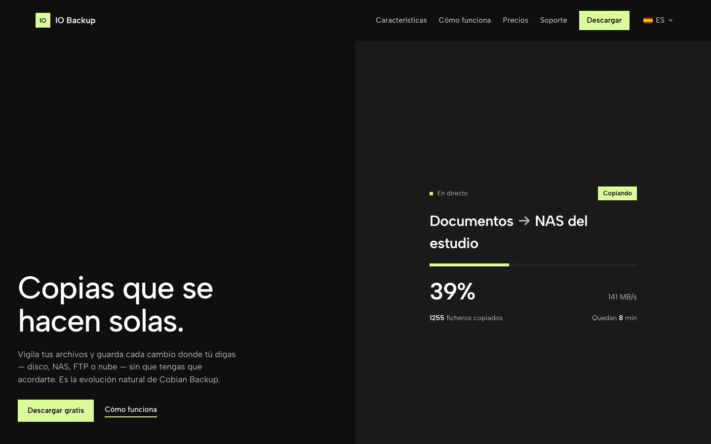

  

<h1 align="center">IO Backup</h1>

A evolução natural do Cobian Backup. Cópias incrementais ao estilo Time Machine com rastreio do filesystem em tempo real — sem varreduras completas.

  
  
  
  

🌍 <a href="README.es.md">🇪🇸 Español</a> · <a href="README.md">🇬🇧 English</a> · <a href="README.de.md">🇩🇪 Deutsch</a> · <a href="README.fr.md">🇫🇷 Français</a> · <a href="README.it.md">🇮🇹 Italiano</a> · <strong>🇵🇹 Português</strong>

> **Este repositório publica apenas releases binários oficiais** — o código-fonte é privado. Downloads assinados, checksums e feeds de atualização automática.

## Transferir

| | |
|---|---|
| 🍎 **macOS 12+** | [IO-Backup.dmg](https://www.io-backup.com/api/dl.php?p=macos&s=github) — sempre a última versão; auto-update incluído |
| 🪟 **Windows** | [IO-Backup-Setup.exe](https://github.com/mavksoft/io-backup-releases/releases/latest) — instalador com serviço em segundo plano |
| 🌍 **Site oficial** | [www.io-backup.com](https://www.io-backup.com) — portal de utilizador, licenças e suporte |

## O que é

O IO Backup é o sucessor espiritual do Cobian Backup: cópias incrementais que produzem snapshots navegáveis — cada execução é um ponto de restauro completo do qual recuperar um ficheiro, uma pasta ou toda a árvore. Um watcher do sistema operativo regista apenas o que muda, por isso cada passagem toca apenas nas novidades.

## Funcionalidades

- **Sem varreduras completas** — USN Journal (Windows), FSEvents (macOS) e inotify (Linux) registam apenas o que muda.
- **Snapshots navegáveis** — cada execução cria um ponto de restauro completo; restaure um ficheiro, uma pasta ou tudo.
- **Retomada real** — se a rede falhar ou desligar a máquina, o run seguinte continua o *mesmo* snapshot onde parou, mesmo a meio de um ficheiro (resume por bytes em FTP).
- **Destinos** — disco local, SMB, FTP/FTPS, SFTP; WebDAV, S3, Google Drive e OneDrive em desenvolvimento.
- **Motor Rust + apps Flutter** — daemon nativo para Windows, macOS e Linux; clientes desktop e móvel (iOS/Android) que controlam PCs e servidores à distância.
- **Índice com histórico completo** — cada versão de cada ficheiro, quando mudou e de que snapshot restaurá-la.
- **Auto-atualização** — a app verifica novas versões a cada 6 h e atualiza-se sozinha.

## Como usar

1. Instale o IO Backup (DMG no macOS, Setup no Windows) e crie uma conta gratuita na app ou em io-backup.com.
2. Crie a primeira tarefa: escolha as pastas a copiar e o destino (disco externo, NAS por SMB/FTP, SFTP…).
3. Programe frequência e retenção — o daemon corre em segundo plano sem janela.
4. Ligue a app móvel para vigiar as cópias e lançar tarefas à distância a partir do iPhone/Android.
5. Para restaurar: abra um snapshot, navegue a árvore como um Finder e recupere o que precisar.

## Requisitos

macOS 12+ · Windows 10+ · daemon Linux disponível · O DMG é assinado Developer ID e notarizado pela Apple.

## O que contém este repositório

- `IO-Backup-<versão>.dmg` — instalador macOS assinado + notarizado
- `IO-Backup-<versão>.zip` — arquivo de auto-atualização macOS
- `IO-Backup-Setup-<versão>.exe` / `IO-Backup-Setup.exe` — instalador Windows (serviço + app)
- `IO-Backup-<versão>-Windows-Portable.zip` — build portable Windows
- `iobackupd.exe` — daemon Windows headless
- `version.json` — feed de versão para o auto-updater

[Versão mais recente](https://github.com/mavksoft/io-backup-releases/releases/latest)

## Perguntas frequentes

**As minhas cópias vão para a vossa cloud?**  
Não por defeito — você escolhe o destino (o seu disco, o seu NAS, o seu FTP). As cópias são suas e vivem onde decidir.

**E se uma cópia for interrompida?**  
O run seguinte retoma o mesmo snapshot exatamente onde parou — mesmo a meio de um ficheiro em destinos FTP.

**É grátis?**  
A edição Personal é gratuita; os planos Pro e Cloud+ desbloqueiam funções avançadas — veja io-backup.com.

## Suporte

- Site e contacto: [www.io-backup.com](https://www.io-backup.com)
- Portal de utilizador, licenças e suporte a partir do portal.

---

IO Backup · © MavkSoft / IT-Systems

